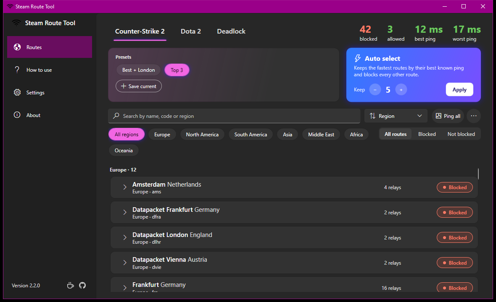
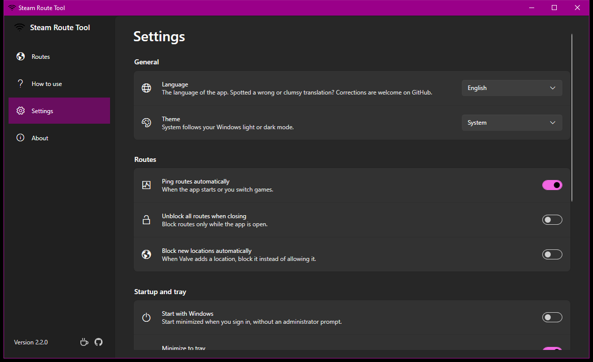

# Steam Route Tool

Choose which Valve relay locations your games can connect to.

Counter-Strike 2, Dota 2 and Deadlock connect you to game servers through Valve's relay network (Steam Datagram Relay). Steam Route Tool blocks the relay locations you don't want with Windows Firewall, so matchmaking only puts you on the servers you choose, for example only nearby ones.

Current version: **2.2.0**. See [CHANGELOG.md](CHANGELOG.md) for what's new.



## Download

Get it from [Releases](../../releases). Both downloads are a single exe with no installer:

- `SteamRouteTool-<version>-win-x64.exe` (about 62 MB): works on any PC, no .NET install needed.
- `SteamRouteTool-<version>-win-x64-small.exe` (about 1 MB): the same app for PCs with the [.NET 10 Desktop Runtime](https://dotnet.microsoft.com/download/dotnet/10.0). Without it, Windows offers to download it.

Requirements:

- Windows 10 or 11 (x64).
- Administrator rights: Windows asks when the app starts, because it creates firewall rules.
- The exe isn't code-signed yet, so SmartScreen may warn the first time: choose **More info**, then **Run anyway**. You can verify the download against `SHA256SUMS.txt`.

## Features

- **Pick a game:** Counter-Strike 2, Dota 2 or Deadlock. The route list comes live from Steam.
- **Block routes with one click** on their Allowed / Blocked pill. Each route can be expanded to block individual relays.
- **Auto select:** one click keeps the 5 fastest routes and blocks the rest (choose another number, with a preview, from the arrow; Undo is one click away).
- **Play in one region:** pick a region chip (or search) and use **Block all except shown** in the ⋯ menu.
- **Sort and filter:** search by name, code or region; filter by region or blocked state; sort by region, name, ping or status. The top shows routes blocked and allowed, and the best and worst ping you still allow.
- **Fast, reliable pings:** a quick round fills the list in a second or two; anything that didn't answer is retried one at a time for networks that drop parallel pings. Last session's pings are shown straight away.
- **Presets:** save the blocked routes under your own names per game (e.g. "EU blocked", "Warsaw only") and switch between them from the Routes page or the tray icon, with Undo.
- **Apply a preset when a game starts:** pick a preset per game, and while the app runs (e.g. in the tray) it's applied as soon as Counter-Strike 2, Dota 2 or Deadlock starts.
- **Game profiles:** each game remembers its blocked routes and applies them when you switch games.
- **Block only while the app is open** (optional): remove all rules when the app closes and re-apply your selection on the next start.
- **Runs in the background** (optional): minimize to the notification area instead of the taskbar, and start with Windows (minimized, without an administrator prompt).
- **Light and dark theme** (Windows 11 style, follows your Windows setting).
- **9 languages:** English, Deutsch, Español, Français, Polski, Português (Brasil), Русский, Türkçe and 简体中文, switchable in Settings without restarting.
- **Updates in one click:** the app checks GitHub at startup and once a day (optional) and shows **Update to x.y.z** at the bottom left; **Update now** downloads the new exe, verifies it against the release's `SHA256SUMS.txt`, swaps it in and restarts.
- **Warns when Windows Firewall is off**, since blocking can't work then.
- **Tells you about new locations** Valve adds (allowed by default, one click to block), or blocks them automatically if you prefer.
- **Keyboard shortcuts:** Ctrl+F search, F5 ping all, Ctrl+1/2/3 switch game. The region, status filter and sort are remembered.
- **Built-in help** and links to the changelog and releases.

The app's **How to use** page has a quick start, common questions (VAC, administrator rights, queue times, FACEIT, privacy) and details on every feature.

## Settings



Settings are grouped like Windows Settings; hover a setting for a longer explanation.

- **General:**
  - **Language:** English by default; switches the whole app instantly.
  - **Theme:** System, Light or Dark.
- **Routes:**
  - **Ping routes automatically** when the app starts or you switch games. Turn it off to see the last known pings until you click **Ping all**.
  - **Unblock all routes when closing:** routes are only blocked while the app is open. Your selection is kept and applied again on the next start.
- **Startup and tray:**
  - **Start with Windows:** starts the app minimized when you sign in, through a Task Scheduler task (named `SteamRouteTool`) that runs it with administrator rights, so there's no prompt.
  - **Close to tray** (on by default): the close button keeps the app running in the tray; exit from the tray menu.
  - **Minimize to tray** (on by default): minimizing hides the window from the taskbar and keeps an icon in the notification area. Click it to open the window; right-click it to switch games and presets, run Auto select, unblock all routes or exit. The close button still exits.
- **Updates:** check now, install a newer version, and turn automatic checks on or off.
- **Files and firewall:** shortcuts to the folder with your settings and game profiles, and to Windows Defender Firewall, where the rules can be inspected.

## How it works

The route list comes from Steam's `ISteamApps/GetSDRConfig` API. Each blocked route gets three outbound Windows Firewall rules (UDP, TCP and ICMP), named `SteamRouteTool-<PROTOCOL>-<route>` and grouped under **SteamRouteTool** in Windows Defender Firewall. The blocked ports come from each relay's port range in the config.

Valve's games share the same relays, and firewall rules apply to the whole PC, so a blocked route is blocked for every game until you unblock it or switch to a game profile that doesn't block it.

On launch, the tool reads its existing rules, shows what's blocked, and brings the rules in line with the current network config in the background. Only rules that differ are rewritten; rules in an outdated format, for routes that no longer exist, or for retired relays are removed.

Settings, game profiles and cached pings are stored in `%LOCALAPPDATA%\SteamRouteTool`. To remove the tool, click **Unblock all** and turn off **Start with Windows**, then delete the exe and that folder.

## Building

Requires the [.NET 10 SDK](https://dotnet.microsoft.com/download/dotnet/10.0) (pinned in `global.json`). The app uses WPF with the built-in Windows 11 (Fluent) theme and [CommunityToolkit.Mvvm](https://github.com/CommunityToolkit/dotnet).

```sh
dotnet build -c Release
dotnet test
```

The output is in `SteamRouteTool/bin/Release/net10.0-windows/`. To open the solution (`SteamRouteTool.slnx`) in Visual Studio, use Visual Studio 2026 or later.

Tests use xUnit v3 on Microsoft.Testing.Platform (enabled in `global.json`) and cover config parsing, regions, pings, settings and firewall rule handling without touching the real firewall. GitHub Actions builds and tests every pull request and push to `main` and `release/**`.

## Translations

All texts are in [`SteamRouteTool/Strings`](SteamRouteTool/Strings), one JSON file per language (`en.json` is the reference). `{0}`, `{1}` are filled in by the app, and `**double asterisks**` mark bold words on the How to use page. Keys ending in `.One` / `.Other` are the singular and plural forms. A missing text falls back to English, and the tests check that every language has every key and keeps the placeholders.

To fix a translation, edit its file and open a pull request. To add a language, copy `en.json` to `<code>.json` (e.g. `it.json`), translate it and add the language to `Loc.Languages` in [`Localization/Loc.cs`](SteamRouteTool/Localization/Loc.cs).

## Releases

Pushing a tag that matches the version in `SteamRouteTool/SteamRouteTool.csproj` (e.g. `v2.0.0`) publishes a self-contained `SteamRouteTool-<version>-win-x64.exe` to [GitHub Releases](../../releases), with `SHA256SUMS.txt` and the matching `CHANGELOG.md` section as release notes. 1.x fixes are released from the `release/1.x` branch.

## Credits

- **Froody** (2019): original author. https://github.com/dfrood/SteamRouteTool
- **eyyMinda** (2026): version 1.0.2 onwards, including the 2.0 redesign. https://github.com/eyyMinda/SteamRouteTool
- App icon: [Feather icons](https://github.com/feathericons/feather).

## License

[GNU General Public License v3.0](LICENSE). Not affiliated with or endorsed by Valve Corporation.
