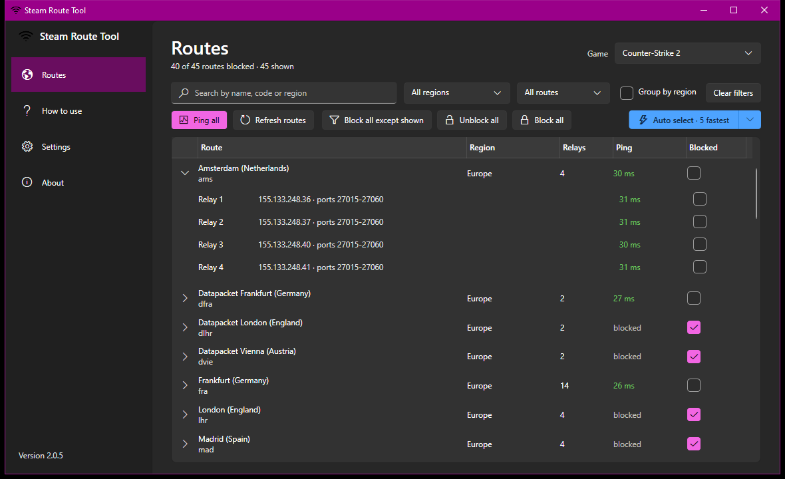
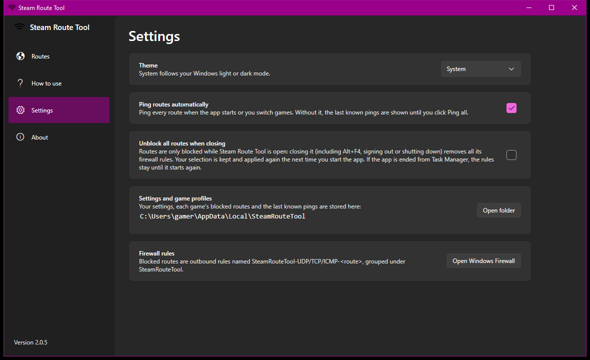

# Steam Route Tool

Choose which Valve relay locations your games can connect to.

Counter-Strike 2, Dota 2 and Deadlock connect you to game servers through Valve's relay network (Steam Datagram Relay). Steam Route Tool blocks the relay locations you don't want with Windows Firewall, so matchmaking only puts you on the servers you choose, for example only nearby ones.

Current version: **2.0.5**. See [CHANGELOG.md](CHANGELOG.md) for what's new.



## Download

Get `SteamRouteTool-<version>-win-x64.exe` from [Releases](../../releases). It's a single self-contained file: no installer and no .NET install needed.

- Windows 10 or 11 (x64).
- Administrator rights: Windows asks when the app starts, because it creates firewall rules.
- The exe isn't code-signed yet, so SmartScreen may warn the first time: choose **More info**, then **Run anyway**. You can verify the download against `SHA256SUMS.txt`.

## Features

- **Pick a game:** Counter-Strike 2, Dota 2 or Deadlock. The route list comes live from Steam.
- **Block routes with one click.** Each route can be expanded to block individual relays.
- **Auto select:** one click keeps the 5 fastest routes and blocks the rest (choose another number, with a preview, from the arrow; Undo is one click away).
- **Play in one region:** filter to a region (or search) and use **Block all except shown**.
- **Sort and filter:** search by name, code or region; filter by region or blocked state; group by region or sort by any column.
- **Fast, reliable pings:** a quick round fills the list in a second or two; anything that didn't answer is retried one at a time for networks that drop parallel pings. Last session's pings are shown straight away.
- **Game profiles:** each game remembers its blocked routes and applies them when you switch games.
- **Block only while the app is open** (optional): remove all rules when the app closes and re-apply your selection on the next start.
- **Light and dark theme** (Windows 11 style, follows your Windows setting).
- **Built-in help, update check and links** to the changelog and releases.

The app's **How to use** page explains everything step by step.

## Settings



- **Theme:** System, Light or Dark.
- **Ping routes automatically** when the app starts or you switch games. Turn it off to see the last known pings until you click **Ping all**.
- **Unblock all routes when closing:** routes are only blocked while the app is open. Your selection is kept and applied again on the next start.
- Shortcuts to the folder with your settings and game profiles, and to Windows Defender Firewall, where the rules can be inspected.

## How it works

The route list comes from Steam's `ISteamApps/GetSDRConfig` API. Each blocked route gets three outbound Windows Firewall rules (UDP, TCP and ICMP), named `SteamRouteTool-<PROTOCOL>-<route>` and grouped under **SteamRouteTool** in Windows Defender Firewall. The blocked ports come from each relay's port range in the config.

Valve's games share the same relays, and firewall rules apply to the whole PC, so a blocked route is blocked for every game until you unblock it or switch to a game profile that doesn't block it.

On launch, the tool reads its existing rules, shows what's blocked, and brings the rules in line with the current network config in the background. Only rules that differ are rewritten; rules in an outdated format, for routes that no longer exist, or for retired relays are removed.

Settings, game profiles and cached pings are stored in `%LOCALAPPDATA%\SteamRouteTool`. To remove the tool, click **Unblock all**, then delete the exe and that folder.

## Building

Requires the [.NET 10 SDK](https://dotnet.microsoft.com/download/dotnet/10.0) (pinned in `global.json`). The app uses WPF with the built-in Windows 11 (Fluent) theme and [CommunityToolkit.Mvvm](https://github.com/CommunityToolkit/dotnet).

```sh
dotnet build -c Release
dotnet test
```

The output is in `SteamRouteTool/bin/Release/net10.0-windows/`. To open the solution (`SteamRouteTool.slnx`) in Visual Studio, use Visual Studio 2026 or later.

Tests use xUnit v3 on Microsoft.Testing.Platform (enabled in `global.json`) and cover config parsing, regions, pings, settings and firewall rule handling without touching the real firewall. GitHub Actions builds and tests every pull request and push to `main` and `release/**`.

## Releases

Pushing a tag that matches the version in `SteamRouteTool/SteamRouteTool.csproj` (e.g. `v2.0.0`) publishes a self-contained `SteamRouteTool-<version>-win-x64.exe` to [GitHub Releases](../../releases), with `SHA256SUMS.txt` and the matching `CHANGELOG.md` section as release notes. 1.x fixes are released from the `release/1.x` branch.

## Credits

- **Froody** (2019): original author. https://github.com/dfrood/SteamRouteTool
- **eyyMinda** (2026): version 1.0.2 onwards, including the 2.0 redesign. https://github.com/eyyMinda/SteamRouteTool
- App icon: [Feather icons](https://github.com/feathericons/feather).

## License

[GNU General Public License v3.0](LICENSE). Not affiliated with or endorsed by Valve Corporation.
